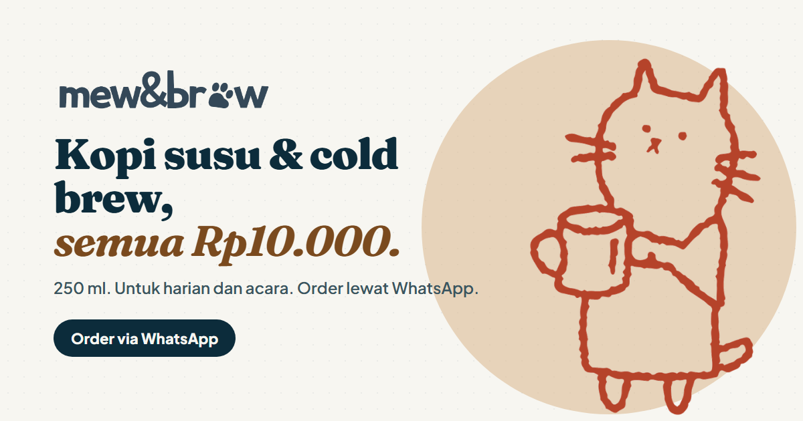

<div align="center">



<h1>Mew &amp; Brew</h1>

<p><strong>Affordable coffee for every occasion.</strong><br />
A mobile-first coffee ordering site with WhatsApp checkout, a flat-price menu, and offline support.</p>

<p>
  
  
  
  
</p>

</div>

---

## Contents

- [Overview](#overview)
- [Features](#features)
- [Tech Stack](#tech-stack)
- [Getting Started](#getting-started)
- [Configuration](#configuration)
- [Deployment](#deployment)
- [PWA and Offline](#pwa-and-offline)
- [Accessibility and Performance](#accessibility-and-performance)
- [Project Structure](#project-structure)
- [License](#license)
- [Contributing](#contributing)
- [Contact](#contact)
- [Credits](#credits)

## Overview

Mew & Brew is an Indonesian coffee brand selling kopi susu and cold brew in 250 ml bottles at a flat **Rp10.000** per bottle. This repository contains the brand's ordering website: customers build a cart, choose pickup or delivery for a daily or event order, and send the final order to the seller on WhatsApp.

The site is a static application. There is no backend, database, or build step. All cart and form state stays in the browser; checkout is a structured WhatsApp message that the seller confirms manually.

## Features

- Seven-product menu with **Kopsu** and **Cold Brew** filters
- Cart with LocalStorage persistence, quick quantities, a 999-bottle cap, and a clear-cart action
- Order numbers tied to the current cart contents, preserved across refreshes
- Daily and event order forms with delivery address, event date, venue, and a custom event type
- WhatsApp message preview, copy-to-clipboard, and direct WhatsApp checkout
- Responsive, mobile-first layout with a mobile navigation strip
- Installable PWA with an offline app shell and cached catalog assets
- Accessible checkout dialog with keyboard focus management and connected field errors
- Reduced-motion support and a contrast-checked color system
- No JavaScript dependencies and no build tooling

## Tech Stack

| Layer | Details |
| --- | --- |
| Frontend | Semantic HTML5, modern CSS (custom properties, Grid, Flexbox), vanilla JavaScript |
| State | `localStorage` for cart, form data, and the active order number |
| Checkout | WhatsApp deep link (`wa.me`) |
| PWA | Web App Manifest and a versioned service worker |
| Build | None — serve the directory as-is |
| Hosting | Any static host |

## Getting Started

Clone the repository and serve the directory with any static file server.

```bash
git clone https://github.com/enpidi26/mewnbrew.git
cd mewnbrew

# Python 3
python3 -m http.server 8000

# or Node.js
npx serve .
```

Open [http://localhost:8000](http://localhost:8000).

> The service worker requires a secure context. Use `http://localhost` for development or HTTPS in production. Opening `index.html` directly with `file://` works for the layout but will not register the PWA.

No package installation or build step is required.

## Configuration

| Setting | Location | Notes |
| --- | --- | --- |
| Seller WhatsApp number | `SELLER_WA` in `js/main.js` | International format, digits only (e.g. `62812...`). |
| Price per bottle | `PRICE` in `js/main.js` | Runtime price display is synchronized from this value. Update the static fallback, meta tags, and JSON-LD when the price changes. |
| Menu | `MENU` in `js/main.js` | New items receive a card automatically. The static HTML remains the no-JS and SEO baseline. |
| Canonical / social URLs | `index.html`, `robots.txt`, `sitemap.xml` | Update for the final domain before deployment. |
| Cache version | `CACHE` in `sw.js` and `?v=` on CSS/JS in `index.html` | Bump both together after changing core assets. |

The public menu data, static fallback cards, and structured data should stay consistent when the catalog changes.

## Deployment

The site can be deployed to any static host.

| Host | Configuration |
| --- | --- |
| Netlify / Cloudflare Pages | `_headers` |
| Vercel | `vercel.json` |
| Apache | `.htaccess` |
| GitHub Pages | Static files only; custom headers are not supported |

Use HTTPS in production. The service worker and install prompt require a secure context. After changing `css/style.css`, `js/main.js`, or core assets, bump the cache version and the asset query string so returning visitors receive the new build.

## PWA and Offline

The service worker caches the application shell, core catalog images, and icons. Navigation falls back to the cached `index.html` when the network is unavailable, so the catalog remains viewable offline. Checkout still requires a network connection to WhatsApp.

- Manifest: `manifest.json`
- Service worker: `sw.js`
- Icons: `assets/img/icon-192.png`, `assets/img/icon-512.png`, `assets/img/icon-maskable-512.png`
- Apple touch icon: `assets/img/apple-touch-icon.png`

## Accessibility and Performance

- Keyboard-operable dialog with focus trapping and focus restoration
- ARIA labels, live announcements, and field errors connected through `aria-describedby`
- Reduced-motion handling for animations and scroll behavior
- Contrast-checked text and focus states
- Lazy loading for below-the-fold images and WebP product assets
- No JavaScript frameworks or third-party runtime dependencies
- Cache-busted CSS and JavaScript for safe long-term caching

Target browsers: current Chrome, Edge, Firefox, and Safari.

## Project Structure

```text
.
├── index.html
├── 404.html
├── manifest.json
├── sw.js
├── _headers
├── vercel.json
├── .htaccess
├── robots.txt
├── sitemap.xml
├── css/
│   └── style.css
├── js/
│   └── main.js
├── assets/
│   └── img/
├── LICENSE
├── NOTICE
├── TRADEMARK.md
├── CHANGELOG.md
└── README.md
```

## License

This project is **source-available, not open source**. The source is public for review, but no permission is granted to use, copy, modify, or distribute the code or brand assets without written permission.

| Component | Terms |
| --- | --- |
| Source code and configuration | Proprietary / source-available |
| Brand assets (name, logo, illustrations, labels, photos, PWA icons, social image) | Proprietary |
| Releases published before 19 November 2026 | MIT; copies already obtained remain MIT |

See [LICENSE](LICENSE) for the binding terms and [TRADEMARK.md](TRADEMARK.md) for the brand policy.

For commercial licensing or brand permission, contact the seller on WhatsApp: [0812-9598-8816](https://wa.me/6281295988816).

## Contributing

This is a proprietary, source-available project. External contributions are not accepted without a prior written agreement. For collaboration or licensing, use the contact below.

## Contact

- WhatsApp: [0812-9598-8816](https://wa.me/6281295988816)
- Repository: [github.com/enpidi26/mewnbrew](https://github.com/enpidi26/mewnbrew)

## Credits

Built by **Navid Athallah and Team**.

Typography: Fraunces and Plus Jakarta Sans, served via Google Fonts under the SIL Open Font License 1.1.

---

**Current release:** v1.2.1 · [Changelog](CHANGELOG.md)
