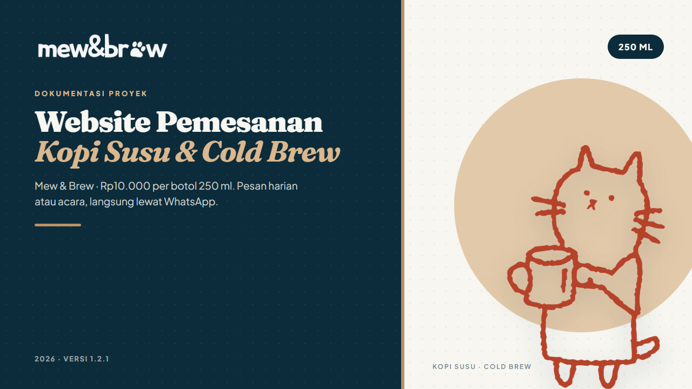
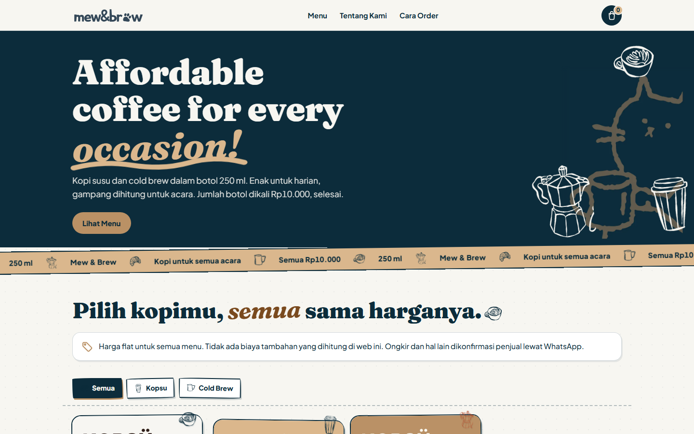
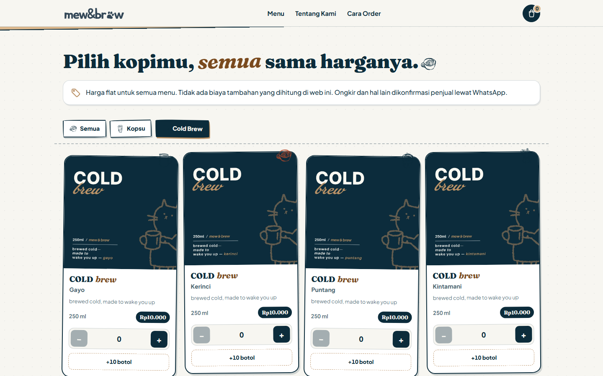
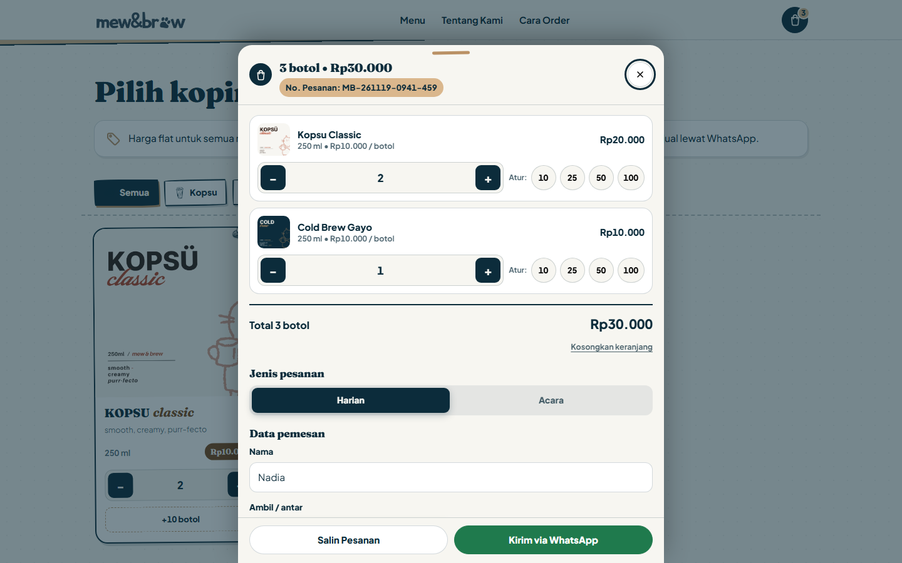

# Laporan Proyek: Mew & Brew

## Nama Proyek

**Mew & Brew — Website Pemesanan Kopi Susu & Cold Brew**

## Ringkasan Singkat

Mew & Brew adalah website pemesanan untuk brand kopi susu dan cold brew. Semua produk berukuran 250 ml dengan harga flat **Rp10.000 per botol**. Pengunjung dapat melihat menu, mengatur jumlah botol, mengisi data pemesanan, lalu mengirim pesanan ke penjual melalui WhatsApp.

Website ini dibuat agar proses pesan lebih rapi dan mudah, terutama untuk pesanan dalam jumlah banyak atau untuk acara. Pembeli tidak perlu membuat akun atau mengunduh aplikasi. Penjual tetap mengonfirmasi ketersediaan, ongkos kirim, dan pembayaran melalui WhatsApp.

## Sekilas Proyek

| Item | Keterangan |
| --- | --- |
| Nama proyek | Mew & Brew — Website Pemesanan |
| Jenis | Website katalog dan pemesanan |
| Produk | Kopi susu (Kopsu) dan cold brew, botol 250 ml |
| Harga | Rp10.000 per botol, sama untuk semua menu |
| Pengguna | Pembeli dan penjual Mew & Brew |
| Perangkat | Ponsel, tablet, dan komputer |
| Proses pemesanan | Pesanan disusun di website, lalu dikirim lewat WhatsApp |
| Status | Versi 1.2.1, siap dipublikasikan |

## Detail Proyek

### Latar Belakang

Mew & Brew menjual kopi susu dan cold brew dengan harga yang sama untuk semua menu. Cara ini membuat pelanggan mudah menghitung biaya, tetapi pesanan yang masuk lewat chat sering bercampur dengan pertanyaan lain: jumlah botol, pilihan rasa, alamat, tanggal acara, dan catatan tambahan.

Website ini membantu merapikan proses tersebut. Pembeli dapat menyusun pesanan sendiri, melihat total, dan memeriksa ringkasan sebelum mengirim. Penjual menerima pesan yang lebih lengkap dan terstruktur, sehingga lebih mudah dicek dan dikonfirmasi.

### Siapa yang Terbantu

- **Pembeli harian** yang ingin memesan beberapa botol untuk dikonsumsi sendiri atau bersama keluarga.
- **Pembeli untuk acara** yang perlu memesan dalam jumlah lebih besar, lengkap dengan tanggal, lokasi, dan alamat pengantaran.
- **Penjual** yang ingin menerima pesanan lebih rapi tanpa harus mencatat ulang dari chat yang berserakan.
- **Panitia acara** yang perlu menghitung anggaran karena harga semua menu sama.

### Cara Kerja

1. **Pilih menu dan jumlah.** Pembeli melihat katalog, memilih Kopsu atau Cold Brew, lalu menekan tombol tambah. Bisa juga menambah 10 botol sekaligus.
2. **Periksa keranjang.** Semua pilihan muncul di keranjang beserta jumlah dan total harga. Jumlah masih bisa diubah atau dikosongkan.
3. **Isi data pesanan.** Pembeli mengisi nama, memilih ambil sendiri atau antar, dan—jika untuk acara—mengisi jenis acara, tanggal, lokasi, serta alamat antar bila diperlukan.
4. **Kirim ke WhatsApp.** Sebelum mengirim, pembeli dapat membaca pratinjau pesan. Setelah itu pesanan dikirim ke WhatsApp penjual, dan penjual mengonfirmasi ketersediaan, pembayaran, serta ongkos kirim.

### Fitur Utama

| Fitur | Manfaat bagi pengguna |
| --- | --- |
| Katalog tujuh menu | Pembeli dapat melihat semua pilihan dalam satu halaman. |
| Filter Kopsu dan Cold Brew | Memudahkan pencarian sesuai selera. |
| Keranjang otomatis | Jumlah dan total dihitung tanpa kalkulator manual. |
| Pesanan harian dan acara | Formulir menyesuaikan kebutuhan: antar, tanggal, lokasi, dan jenis acara. |
| Pilihan "Lainnya" untuk acara | Pembeli dapat menuliskan jenis acara yang tidak ada di daftar. |
| Nomor pesanan | Membantu penjual mengenali dan mencari pesanan. |
| Pratinjau pesan | Pembeli dapat memeriksa isi pesan sebelum dikirim. |
| Salin pesanan | Pesanan bisa dikirim manual jika WhatsApp tidak terbuka otomatis. |
| Keranjang tersimpan | Pilihan tidak hilang saat halaman dimuat ulang. |
| Tampilan ponsel | Tombol dan formulir dibuat nyaman untuk layar kecil. |
| Tanpa akun | Pembeli tidak perlu mendaftar atau membuat kata sandi. |
| Bisa dipasang dan dibuka kembali | Di perangkat yang mendukung, website dapat dipasang seperti aplikasi; katalog juga dapat dibuka saat koneksi buruk. |

### Pengalaman Pengguna

Website dirancang untuk ponsel terlebih dahulu. Menu, tombol jumlah, dan formulir disusun agar mudah dijangkau dengan satu tangan. Di komputer, tampilan tetap rapi dan nyaman digunakan.

Beberapa hal yang membuat pemesanan lebih mudah:

- Total harga terlihat langsung saat jumlah botol berubah.
- Pesanan untuk acara memiliki formulir tambahan yang muncul hanya saat dibutuhkan.
- Kesalahan pengisian dijelaskan di dekat kolom yang perlu diperbaiki.
- Keranjang dapat dikosongkan dengan satu tombol.
- Pesan WhatsApp sudah berisi daftar menu, jumlah, total, data pemesan, dan catatan.
- Website dapat digunakan dengan keyboard, dan dialog keranjang dapat ditutup dengan tombol Escape.
- Animasi dapat dikurangi bagi pengguna yang memilih pengaturan tersebut di perangkatnya.

### Privasi dan Data

Website ini tidak meminta pembeli membuat akun. Nama, alamat, catatan, dan data pesanan lain disimpan di browser pembeli agar tidak hilang saat halaman dimuat ulang. Data tersebut baru dikirim ke penjual ketika pembeli menekan tombol WhatsApp, dan pengirimannya terjadi melalui aplikasi WhatsApp.

Mew & Brew tidak menyimpan data pelanggan di sistem miliknya. Jika data browser dihapus, data yang tersimpan di perangkat juga akan hilang.

### Batasan yang Perlu Diketahui

- **Belum ada pembayaran online.** Pembayaran dan ongkos kirim dikonfirmasi langsung oleh penjual melalui WhatsApp.
- **Stok tidak otomatis.** Ketersediaan produk tetap dikonfirmasi penjual setelah pesan diterima.
- **Ongkos kirim tidak dihitung otomatis.** Nominal ongkir menyesuaikan lokasi dan akan diinformasikan penjual.
- **Bukan sistem pelacakan pesanan.** Nomor pesanan membantu komunikasi, tetapi bukan bukti pembayaran atau resi pengiriman.
- **Katalog bisa dibuka tanpa koneksi, pengiriman pesanan tetap butuh internet.** Katalog dapat dibuka kembali saat koneksi buruk, tetapi pengiriman pesanan ke WhatsApp memerlukan internet.
- **Pesanan tetap dikonfirmasi manusia.** Website membantu menyusun pesanan; keputusan akhir mengenai ketersediaan dan pembayaran ada pada penjual.

## Galeri

### Beranda

*Halaman pembuka dengan penjelasan singkat, harga flat, dan tombol menuju menu.*

### Menu Cold Brew

*Katalog dengan filter aktif. Pembeli dapat melihat pilihan, harga, dan menambah jumlah botol.*

### Keranjang dan Data Pesanan

*Ringkasan pesanan, total, pilihan harian atau acara, dan data pemesan. Nama pada gambar hanya contoh.*

## Status dan Kontak

Website berada pada versi **1.2.1** dan siap dipublikasikan di internet. Untuk pertanyaan, pemesanan, atau kerja sama:

- WhatsApp: [0812-9598-8816](https://wa.me/6281295988816)
- Dibuat oleh: **Navid Athallah and Team**

## Hak Cipta

© 2026 Mew & Brew. Seluruh hak dilindungi. Kode dan aset brand tidak boleh dipakai, disalin, atau didistribusikan tanpa izin tertulis. Ketentuan lengkap ada di [LICENSE](../LICENSE) dan [TRADEMARK.md](../TRADEMARK.md).
